---
widget: blank
headless: true

# ... Put Your Section Options Here (title etc.) ...
title: Research
subtitle:
weight: 10  # section position on page
design:
  # Choose how many columns the section has. Valid values: 1 or 2.
  columns: '1'
---

<button id="toggle" class="toggle" type="button" data-lang="zh">EN</button>

研究以模式识别与机器学习为主线，二十余年的积累串成一条从数据到模型的完整链条：从多元数据分析与可视化起步，进入对抗样本的生成与防御、协同训练与知识蒸馏，最终走向生成模型与数据增强。对抗样本揭示模型的脆弱之处，生成式数据增强则把这种敏感性转化为可用的多样性——两者指向同一个目标：以更优质的数据与更稳健的学习过程，提升模型的鲁棒性与泛化能力。

Research centres on pattern recognition and machine learning, where two decades of work form a single chain from data to model: multivariate data analysis and visualization first, then the generation and defense of adversarial examples, then collaborative training and knowledge distillation, and finally generative models and data augmentation. Adversarial examples expose where a model is fragile; generative data augmentation turns that same sensitivity into usable diversity — both serving one goal: better data and more robust learning, for models that are accurate, resilient and generalizable.

目录 / ContentsContents

<ol>
<li><a href="#overview">研究领域总览Research Overview</a></li>
<li><a href="#adversarial-examples">Ⅰ 对抗样本的生成与防御Ⅰ Generating and Defending Adversarial Examples</a></li>
<li><a href="#collaborative-distillation">Ⅱ 协同训练与知识蒸馏Ⅱ Collaborative Training and Knowledge Distillation</a></li>
<li><a href="#generative-augmentation">Ⅲ 生成模型与数据增强Ⅲ Generative Models and Data Augmentation</a></li>
<li><a href="#summary">总结：从对抗样本到生成式数据增强Summary: From Adversarial Examples to Generative Data Augmentation</a></li>
</ol>

 

<!-- overview -->

<h2>研究领域总览Research Overview</h2>

研究领域为模式识别与机器学习，形成四个相互支撑的板块，时间跨度自 2005 年延续至今：

Research centres on pattern recognition and machine learning, organized into four mutually supporting blocks that span from 2005 to the present:

<h4>多元数据分析与可视化Multivariate Data Analysis &amp; Visualization</h4>
指纹方向场建模；去噪、重建与检索；基于 GLM 与多种重采样方法的高维离散数据统计分析工具包 mvabund，被收录进 CRAN 国际档案大全。Fingerprint orientation-field modelling; denoising, reconstruction and retrieval; the mvabund toolbox for high-dimensional discrete data built on GLM and multiple resampling methods, archived in CRAN.

<h4><a href="#adversarial-examples">对抗样本的生成与防御</a><a href="#adversarial-examples">Generating and Defending Adversarial Examples</a></h4>
对抗机器学习（AML）、对抗训练、对抗检索；生物特征隐私保护；查询安全高效的 CBIR 图像检索系统。Adversarial machine learning (AML), adversarial training and adversarial retrieval; biometric privacy protection; query-secure and query-efficient CBIR systems.

<h4><a href="#collaborative-distillation">协同训练与知识蒸馏</a><a href="#collaborative-distillation">Collaborative Training &amp; Knowledge Distillation</a></h4>
联邦学习、模型蒸馏、数据集蒸馏；师生模型与对抗蒸馏。Federated learning, model distillation and dataset distillation; teacher–student models and adversarial distillation.

<h4><a href="#generative-augmentation">生成模型与数据增强</a><a href="#generative-augmentation">Generative Models &amp; Data Augmentation</a></h4>
数据增强、参数高效微调（PEFT）；GAN、自回归 Transformer 与扩散模型驱动的数据生成。Data augmentation and parameter-efficient fine-tuning (PEFT); data generation driven by GANs, autoregressive Transformers and diffusion models.

 

<!-- adversarial-examples -->

<h2>Ⅰ · 对抗样本的生成与防御Ⅰ · Generating and Defending Adversarial Examples</h2>

对抗机器学习Adversarial ML对抗训练Adversarial training对抗检索Adversarial retrieval

<h3>对抗机器学习Adversarial Machine Learning</h3>

传统机器学习建立在“静态环境”的平稳性假设之上；真实开放环境打破这一假设，攻击者可通过数据投毒、白盒攻击、黑盒攻击与绕过检测等手段破坏模型。

Classical machine learning rests on a stationarity assumption about a static environment. Real open-world deployment breaks that assumption: attackers can poison data, mount white-box or black-box attacks, or bypass detection.

<ul class="zh">
<li><strong>平稳性假设</strong>：训练/测试数据独立同分布，统计特性不随时间改变。</li>
<li><strong>该假设支撑</strong>：模型有效性、预测可靠性、统计检验性。</li>
<li><strong>开放环境</strong>：对抗样本的生成与防御成为模型落地的必要环节。</li>
</ul>
<ul class="en">
<li><strong>Stationarity assumption</strong>: training and test data are i.i.d., and statistical properties do not drift over time.</li>
<li><strong>What it underpins</strong>: model validity, prediction reliability and statistical testability.</li>
<li><strong>Open environment</strong>: generating and defending adversarial examples becomes indispensable for deployment.</li>
</ul>

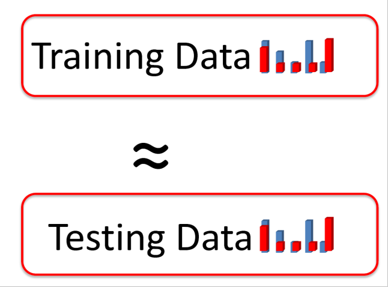

图1 平稳性假设：训练数据与测试数据同分布，是模型可靠性与统计检验性成立的前提。Figure 1 Stationarity: model reliability and statistical testability hold only when training and test data share one distribution.

 

<h3>基于内容查询的图像检索攻击Attacking Content-Based Image Retrieval</h3>

针对 CBIR 系统提出一种自适应的决策型黑盒算法，大幅减少 87% 的系统查询次数，并在微软必应 Bing 等商业检索引擎上展示了攻击有效性：原始图像的检索结果（如 wardrobe）被对抗样本整体改写为 tapestry、painting、tiles 等无关结果。

For CBIR systems we propose an adaptive decision-based black-box algorithm that cuts system queries by 87%, and demonstrate its effectiveness on commercial engines such as Microsoft Bing: the original retrieval results (e.g. wardrobe) are rewritten by an adversarial sample into unrelated results such as tapestry, painting and tiles.

<ul class="zh">
<li>查询高效：决策型黑盒设定下大幅压缩查询预算。</li>
<li>真实可用：在商业视觉检索（Bing 相似图片）上验证。</li>
<li>面向检索：攻击目标是 top-K 检索结果，而非单一分类标签。</li>
</ul>
<ul class="en">
<li>Query-efficient: sharply reducing the query budget under a decision-based black-box setting.</li>
<li>Practically valid: verified on a commercial visual search engine (Bing Similar Images).</li>
<li>Retrieval-oriented: the target is the top-K retrieved set, not a single class label.</li>
</ul>

图2 在微软必应视觉检索（商业 CBIR 系统）上验证黑盒攻击的有效性。Figure 2 The black-box attack validated on Microsoft Bing visual search, a commercial CBIR system.

M. Chen, J. Lu, Y. Wang, J. Qin and W. Wang. “DAIR: A Query-Efficient Decision-Based Attack On Image Retrieval Systems”, <em>ACM SIGIR’21</em> [C], 2021, Virtual Event, 1064–1073.

 

<h3>联邦学习中的数据重构与隐私泄露Data Reconstruction and Privacy Leakage in Federated Learning</h3>

根据客户端上传到服务器的信息，对其本地数据集实施隐私保护攻击，包括样本重构、参数泄漏、成员推断与属性推断等。

From the information clients upload to the server, we mount privacy attacks on their local datasets — sample reconstruction, parameter leakage, membership inference and property inference.

<ul class="zh">
<li>揭示了协同学习中“共享参数”并不等于“共享安全”。</li>
<li>在深度特征空间对客户端本地数据集进行属性推断。</li>
<li>给出客户端样本重构的准确率比较，量化泄露风险。</li>
</ul>
<ul class="en">
<li>Shows that sharing parameters in collaborative learning is not the same as sharing safety.</li>
<li>Performs property inference on a client’s local dataset in deep feature space.</li>
<li>Reports client-side sample reconstruction accuracy to quantify the leakage risk.</li>
</ul>

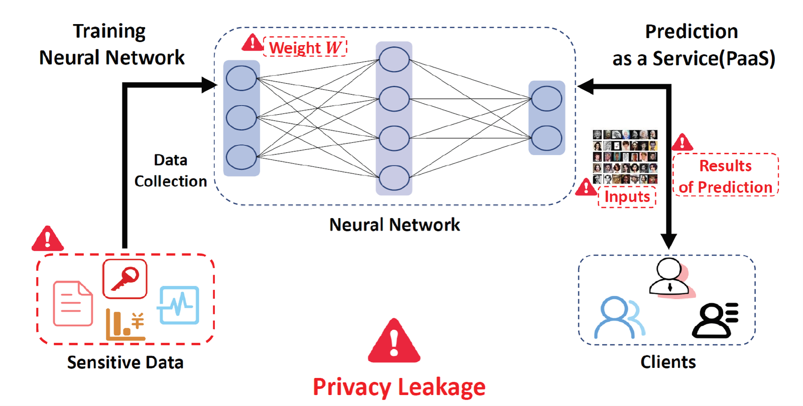

图3 联邦学习中的隐私泄露路径：客户端上传的模型信息被用于属性推断与样本重构。Figure 3 Privacy leakage in federated learning: uploaded model information enables property inference and sample reconstruction.

H. Yang, Y. Wang and B. Li. “Individual Property Inference Over Collaborative Learning In Deep Feature Space”, <em>IEEE ICME’22</em> [C], 2022, Taipei, Taiwan, 1–6.

 

<h3>集成深度模型的对抗稳健性Adversarial Robustness of Deep Ensembles</h3>

基模型高层特征的多样化表示可以显著提升集成深度学习模型的对抗稳健性，据此提出优先多样化 Dropout（PDD）与分散式集成梯度（DEG）。

Diversified high-level feature representations across base networks markedly improve the adversarial robustness of deep ensembles — realized as Priority Diversified Dropout (PDD) and Dispersed Ensemble Gradients (DEG).

<ul class="zh">
<li>以 Grad-CAM 可视化对比基线、ADP 与 PDD 下各基网络对最后一层 FC 的关注区域。</li>
<li>CIFAR-100 上 2000 张测试图像的平均判别分数箱线图：分数越高，基网络间 FC 特征差异越大（K = 3）。</li>
</ul>
<ul class="en">
<li>Grad-CAM comparison of the last fully-connected layer for each base network under baseline, ADP and PDD.</li>
<li>Box-plots of the average discrimination score over 2000 CIFAR-100 test images — a higher value means larger FC-feature divergence among base networks (K = 3).</li>
</ul>

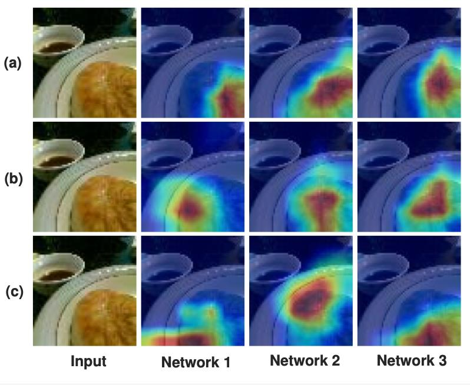

图4 集成模型中各基网络最后一层 FC 的 Grad-CAM 对比：(a) 基线、(b) ADP、(c) PDD（本文方法）。Figure 4 Grad-CAM of the last FC layer in each base network: (a) baseline, (b) ADP, (c) PDD (ours).

B. Huang, Z. Ke, Y. Wang, W. Wang, L. Shen and F. Liu. “Adversarial Defence By Diversified Simultaneous Training Of Deep Ensembles”, <em>AAAI’21</em> [C], 2021, Virtual Event, 35(9), 7823–7831.

 

<!-- collaborative-distillation -->

<h2>Ⅱ · 协同训练与知识蒸馏Ⅱ · Collaborative Training and Knowledge Distillation</h2>

联邦学习Federated learning师生模型Teacher–student models模型蒸馏Model distillation对抗蒸馏Adversarial distillation

该方向关注的核心矛盾是：多客户端长尾数据导致协作偏差并影响收敛。研究围绕隐私—效用与通信效率、模型鲁棒性与泛化能力、多模态表征对齐与多路编码器融合、多场景应用下的模型泛化与自适应能力展开。

The central tension: long-tailed data across many clients induces collaboration bias and hurts convergence. Research addresses privacy–utility and communication efficiency, model robustness and generalization, multimodal representation alignment and multi-encoder fusion, and cross-scenario generalization and adaptivity.

<h3>联邦蒸馏解决长尾数据分布导致的协作偏差Federated Distillation against Long-Tailed Collaboration Bias</h3>

多客户端数据呈现长尾分布（Non-IID），带来安全隐私保护、客户端过拟合、收敛慢且不稳定、策略异质性四类挑战；以“联邦蒸馏 + 数据增强”应对：基于实例的自然采样与基于类别的均衡采样协同，在服务器端优化聚合与平滑统计，并对分类器偏差进行校准。

Client data are long-tailed (Non-IID), raising four challenges — privacy protection, client over-fitting, slow and unstable convergence, and strategy heterogeneity. The answer is federated distillation plus data augmentation: instance-based natural sampling combined with class-based balanced sampling, server-side optimization of aggregation and smoothed statistics, and calibration of classifier bias.

<ul class="zh">
<li>更适合表示学习的采样与更适合分类器学习的采样互补。</li>
<li>针对分类器偏差与泛化能力不足进行显式校准。</li>
</ul>
<ul class="en">
<li>Samples better suited to representation learning complement those better suited to classifier learning.</li>
<li>Explicit calibration against classifier bias and limited generalization.</li>
</ul>

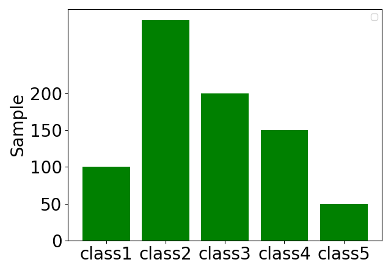

图5 客户端本地数据的类别分布示意：长尾导致协作偏差与分类器偏置。Figure 5 Class distribution of client data: the long tail induces collaboration bias and classifier bias.

 

<h3>客户端自蒸馏Client Self-Distillation</h3>

通过引入随机变换生成的蒸馏数据，并结合多个子网络的软标签对齐（Logits Transfer），增强模型内部知识多样性，抑制本地过拟合。

Randomly transformed distillation data, combined with soft-label alignment (logits transfer) across multiple sub-networks, strengthens intra-model knowledge diversity and suppresses local over-fitting.

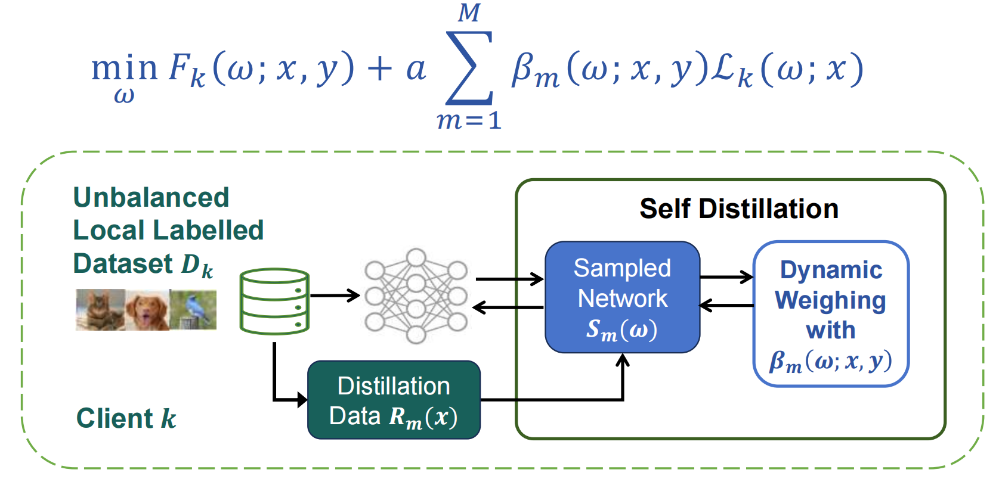

图6 客户端自蒸馏：随机变换生成蒸馏数据，并通过多个子网络的软标签对齐抑制本地过拟合。Figure 6 Client self-distillation: distillation data from random transforms, with logits transfer across sub-networks to curb local over-fitting.

 

<h3>服务器集成蒸馏Server Ensemble Distillation</h3>

通过类别均衡的第三方无标签代理数据集引导多方位知识迁移，对齐师生模型在其上的特征表示与软标签；三重对齐模型权重、特征表示与软标签输出，学习更紧凑的特征并优化损失空间结构，提升全局模型的鲁棒性和泛化能力。

A class-balanced, third-party unlabeled proxy dataset steers multi-faceted knowledge transfer, aligning teacher and student representations and soft labels on it. Triple alignment — model weights, feature representations and soft-label outputs — yields more compact features and a better-structured loss space, improving global robustness and generalization.

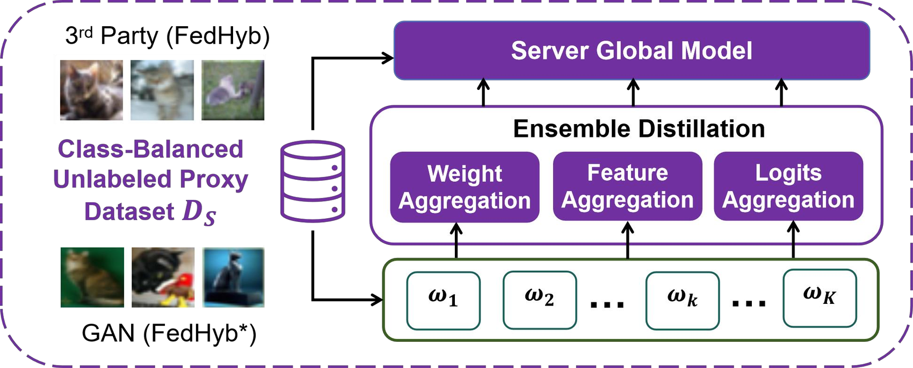

图7 服务器集成蒸馏（FedHyb）：在类别均衡的无标签代理数据集上做权重、特征与软标签三重聚合。Figure 7 Server ensemble distillation (FedHyb): weight, feature and logits aggregation on a class-balanced unlabeled proxy dataset.

S. Liu, Y. Zhang, K. Zhang and Y. Wang. “Federated Learning with Hybrid Knowledge Distillations on Long-Tailed Heterogeneous Client Data”, <em>ECAI’24</em> [C], 2024, Santiago de Compostela, Spain, vol. 392, 2878–2885.

 

<h3>突破联邦学习在长尾异构下的性能瓶颈Breaking the Long-Tailed Heterogeneity Bottleneck</h3>

在不同数据异质性指标 α 与长尾分布指标 IF 下，所提方法在 SVHN、CIFAR-10 以及医学影像基准数据集 CheXpert 上均取得更高的全局测试准确率。

Across data-heterogeneity level α and long-tail indicator IF, the method achieves higher global test accuracy on SVHN, CIFAR-10 and the medical imaging benchmark CheXpert.

<ul class="zh">
<li>达到目标精度所需的通信轮次显著减少。</li>
<li>对恶意客户端下的毒攻击更鲁棒（随机噪声攻击、拜占庭攻击）。</li>
</ul>
<ul class="en">
<li>Markedly fewer communication rounds to reach a target accuracy.</li>
<li>More robust to poisoning by malicious clients (random-noise and Byzantine attacks).</li>
</ul>

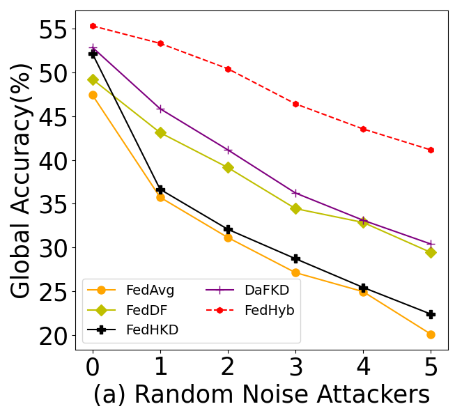

图8 随机噪声攻击下的全局准确率：所提方法在各攻击强度下均最优。Figure 8 Global accuracy under random-noise attackers: the proposed method is best at every attack strength.

 

<h3>自适应的对抗蒸馏法（AdaAD）Adaptive Adversarial Distillation (AdaAD)</h3>

传统对抗训练在小容量学生模型上提升鲁棒性并不理想，常出现精度与鲁棒性失衡。AdaAD 在对抗博弈框架下优化大小模型之间的蒸馏过程：模拟近似推导二者的最大点对点对齐关系，在内部优化中自适应搜索最优匹配点（锚点），通过小模型生成对抗训练数据以增加大小模型间互动，并设计新的对抗蒸馏目标。

Conventional adversarial training struggles on small-capacity students, often trading accuracy for robustness. AdaAD optimizes teacher–student distillation inside an adversarial-game framework: it derives the maximal point-to-point alignment between the two models, adaptively searches for the best anchor during inner optimization, generates adversarial training data through the student to increase interaction, and designs a new adversarial distillation objective.

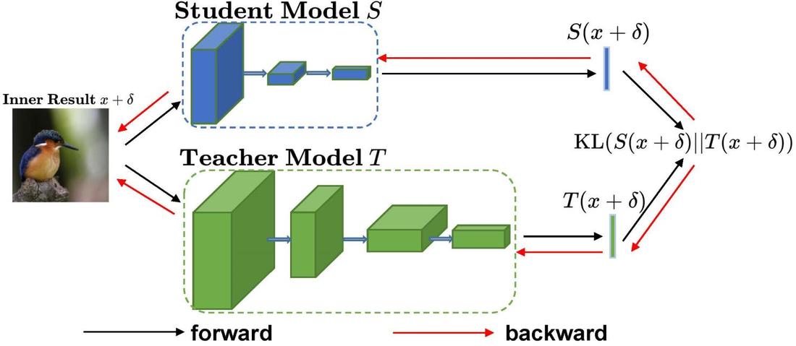

图9 AdaAD 的师生蒸馏框架与自适应锚点搜索过程。Figure 9 The AdaAD teacher–student distillation framework with adaptive anchor search.

B. Huang, M. Chen, Y. Wang, J. Lu, M. Cheng and W. Wang. “Boosting Accuracy and Robustness Of Student Models Via Adaptive Adversarial Distillation”, <em>IEEE/CVF CVPR’23</em> [C], 2023, Vancouver, Canada, 24668–24677.

 

<!-- generative-augmentation -->

<h2>Ⅲ · 生成模型与数据增强Ⅲ · Generative Models and Data Augmentation</h2>

数据增强Data augmentation数据集蒸馏Dataset distillation参数高效微调（PEFT）Parameter-efficient fine-tuning

<h3>图像生成模型Image Generation Models</h3>

涵盖生成式对抗网络 GAN、自回归 Transformer 与 Diffusion 扩散模型三条技术路线，面向四类需求：满足小样本学习、符合常理和常识、减少算力和内存、具备局部编辑可控性——即可靠、鲁棒、高效。

Three technical routes — GANs, autoregressive Transformers and diffusion models — serve four requirements: few-shot capability, commonsense plausibility, reduced compute and memory, and controllable local editing, i.e. reliable, robust and efficient generation.

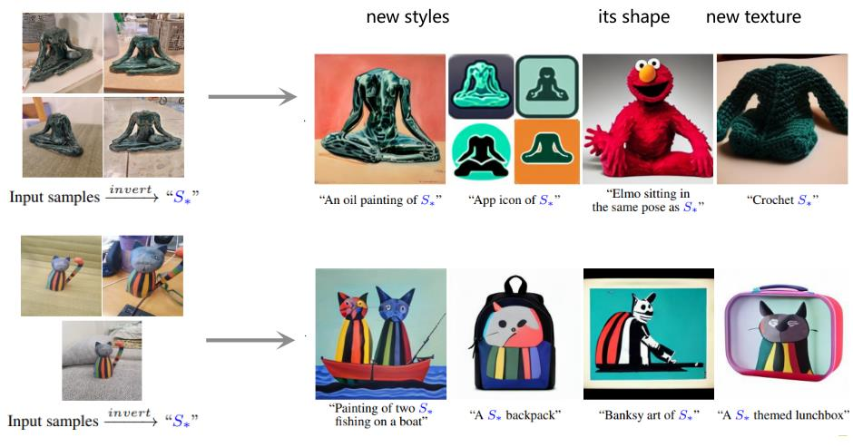

图10 图像生成模型的可控编辑：新风格、形状与新纹理。Figure 10 Controllable editing with image generation models: new styles, new shape, new texture.

 

<h3>生成式数据增强：对抗数据增强Generative Augmentation: Adversarial Data Augmentation</h3>

在主网络中插入鲁棒特征适配器（RFA），通过在特征空间动态自适应生成对抗扰动，有效解决传统对抗训练计算开销大和鲁棒过拟合的问题；推理阶段插拔 RFA 适配器还可用于对抗检测。

A Robustness Feature Adapter (RFA) inserted into the main network dynamically generates adversarial perturbations in feature space, solving the high computational cost and robust over-fitting of conventional adversarial training; the adapter can be plugged in or out at inference for adversarial detection.

<ul class="zh">
<li>ViT 对抗训练效率提升 4 倍以上。</li>
<li>模型复杂度增加不足 1/10，鲁棒性增益可超过 50%。</li>
</ul>
<ul class="en">
<li>Over 4× faster adversarial training for ViT.</li>
<li>Less than 1/10 added model complexity, with robustness gains above 50%.</li>
</ul>

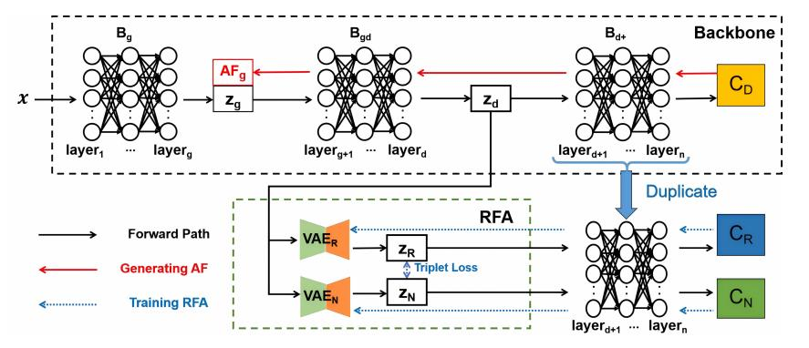

图11 RFA 的插入位置与训练/推理流程：仅更新适配器参数即可生成对抗扰动。Figure 11 Where RFA is inserted, and its training/inference flow: only adapter parameters are updated to generate perturbations.

Q. Wu, J. Guo, W. Wang and Y. Wang. “Robustness Feature Adapter for Efficient Adversarial Training”, <em>ECAI’25</em> [C], 2025, Bologna, Italy, vol. 413, 3451–3459.

 

<h3>“插件式”RFA 对抗训练的收敛质量与效率Convergence Quality and Efficiency of Plug-in RFA</h3>

从效率与收敛质量两方面评估 RFA：仅更新适配器参数即可显著降低计算开销，尤其适用于大规模预训练模型（如 ViT）的对抗训练；尽管训练速度快，仍能保持较低的 FOSC 值，说明生成的对抗样本质量高，有助于提升鲁棒性泛化能力。该结构亦可迁移至个性化联邦学习，同时增强客户端对抗鲁棒性。

RFA is evaluated on both efficiency and convergence quality: updating only adapter parameters sharply cuts computation, especially for large pre-trained models such as ViT; despite fast training it maintains a low FOSC value, indicating high-quality adversarial examples that improve robustness generalization. The same design transfers to personalized federated learning while strengthening client-side adversarial robustness.

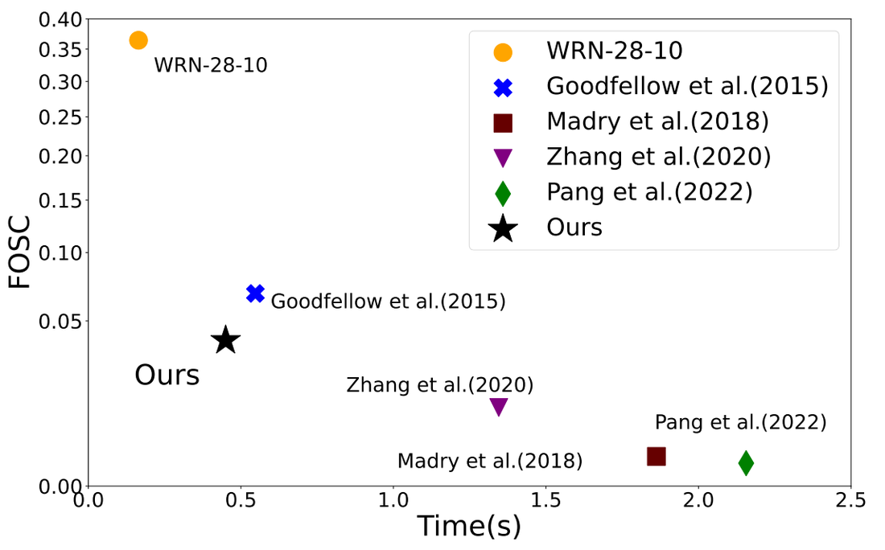

图12 每批次训练时间与 FOSC 的关系：兼顾训练效率与对抗样本质量。Figure 12 Training time per batch vs FOSC: efficiency together with adversarial-sample quality.

 

<h3>生成式数据增强：自适应下游多任务模型Generative Augmentation: Adapting to Downstream Multi-Task Models</h3>

情景自适应的数据增强（IGD）在推理阶段利用外部约束（目标梯度），引导反向扩散过程动态自适应地生成能够等效训练下游任务模型的代理数据集，实现生成模型免微调、高效率地控制反向去噪过程。

Scene-adaptive data augmentation (IGD) uses external constraints — target gradients — at inference time to steer the reverse diffusion process, dynamically generating a proxy dataset that can equivalently train downstream models. The generative model needs no fine-tuning, and the reverse denoising process is controlled efficiently.

<ul class="zh">
<li>设计自定义的外部属性梯度作为引导函数。</li>
<li>在反向去噪的推断采样阶段施加定向吸引力或排斥力。</li>
<li>引导生成过程自适应下游任务目标，避免昂贵的生成模型重训练。</li>
</ul>
<ul class="en">
<li>A custom external attribute gradient serves as the guidance function.</li>
<li>Directed attraction or repulsion is applied during inference-time reverse denoising.</li>
<li>Generation adapts to the downstream objective, avoiding costly retraining of the generator.</li>
</ul>

图13 真实样本（虚线左）与生成的代理样本（虚线右）对比。Figure 13 Real samples (left of the dashed line) vs generated proxy samples (right).

M. Chen, J. Du, B. Huang, Y. Wang, X. Zhang and W. Wang. “Influence-Guided Diffusion for Dataset Distillation”, <em>ICLR’25</em> [C], 2025, Singapore, 1287–1308.

 

<h3>生成式数据增强：数据蒸馏代表性样本Generative Augmentation: Representative Samples via Data Distillation</h3>

核心数据集蒸馏法（Core-Set Selection）将大型真实数据集的核心知识提炼到小规模合成或筛选数据集，可用于持续/增量学习与边缘设备部署；通过 DDPM 部分逆去噪过程中引发的重建偏差，反映并量化潜在的数据似然度。

Core-set selection distils the core knowledge of a large real dataset into a small synthesized or selected set, serving continual/incremental learning and edge deployment. Reconstruction bias induced by partial reverse denoising in DDPM reflects and quantifies the underlying data likelihood.

<ul class="zh">
<li>高似然样本：重构偏差小。</li>
<li>低似然样本：语义变化、视觉显著性下降。</li>
<li>选择最优重建时刻 t，使目标落在给定区间内。</li>
</ul>
<ul class="en">
<li>High-likelihood samples: small reconstruction bias.</li>
<li>Low-likelihood samples: semantic drift and declining visual saliency.</li>
<li>Select the optimal reconstruction step t so that the target falls within the required interval.</li>
</ul>

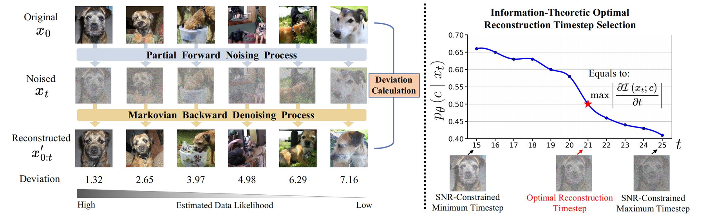

图14 以部分逆去噪的重建偏差估计数据似然度，并据此确定最优重建时刻 t。Figure 14 Data likelihood estimated from the reconstruction deviation of partial reverse denoising, yielding the optimal reconstruction timestep t.

M. Chen, J. Du, B. Huang, Y. Wang, X. Zhang and W. Wang. “Diffusion Reconstruction-based Data Likelihood Estimation for Core-Set Selection”, <em>AAAI’26</em> [C], 2026, Singapore.

 

<h3>生成式数据增强：多模态医学图像融合Generative Augmentation: Multimodal Medical Image Fusion</h3>

通过多模态特征融合与分布对齐的协同优化，提高模型对复杂异构数据的表征能力，从而提升整体预测精度。

Coordinated multimodal feature fusion and distribution alignment strengthen the model’s representation of complex heterogeneous data, raising overall predictive accuracy.

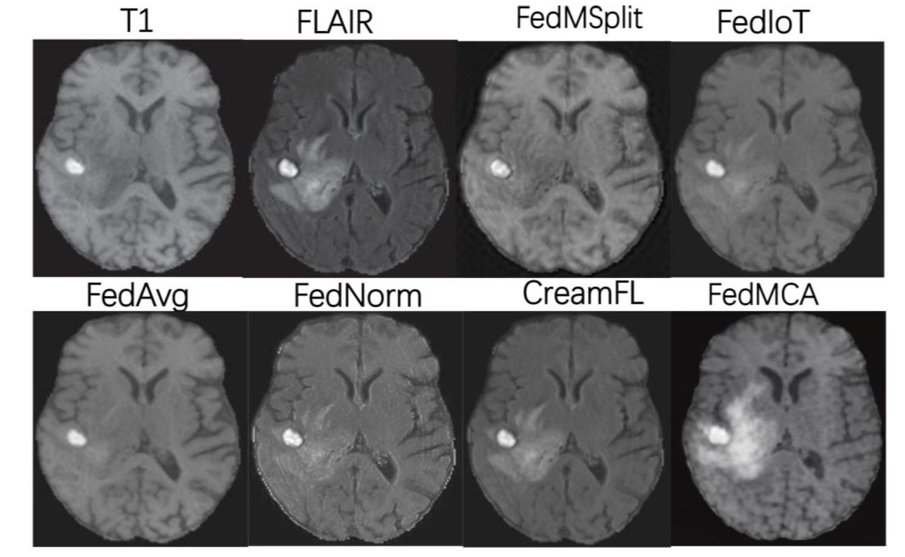

图15 CheXpert 上的多模态联邦方法对比（FedMCA 为本团队方法）。Figure 15 Multimodal federated methods on CheXpert (FedMCA is ours).

Y. Zhang, S. Liu, B. Fang and Y. Wang. “FedMCA: Cross-Attention-Based Personalized Multimodal Federated Learning Under Modality Heterogeneity”, <em>ICMSSP’26</em> [C], 2026, Hiroshima, Japan.

 

<h3>生成式数据增强：单轮通信的联邦学习Generative Augmentation: One-Shot Communication Federated Learning</h3>

数据生成阶段基于对抗博弈的多专家蒸馏融合客户端编码器；模型蒸馏阶段将融合后的集成编码器知识蒸馏到全局模型。由此服务器可通过单轮通信学习全局模型，有效降低客户端的通信成本与安全风险。

In the data-generation stage, multi-expert distillation under an adversarial game fuses client encoders; in the model-distillation stage, the fused ensemble-encoder knowledge is distilled into the global model. The server can therefore learn a global model in a single communication round, cutting client communication cost and security risk.

<ul class="zh">
<li>无需额外信息交换：只需在客户端与服务器之间传输模型参数。</li>
<li>无需辅助数据集（data-free）：服务器不需要额外的训练数据。</li>
<li>考虑模型异质性：适应不同客户端拥有不同的模型架构。</li>
</ul>
<ul class="en">
<li>No extra information exchange: only model parameters travel between clients and server.</li>
<li>No auxiliary dataset (data-free): the server needs no additional training data.</li>
<li>Model heterogeneity aware: accommodates clients with different architectures.</li>
</ul>

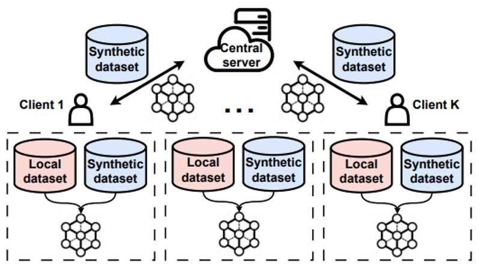

图16 单轮通信联邦学习：客户端合成数据与服务器端集成蒸馏。Figure 16 One-shot federated learning: client-side synthetic data plus server-side ensemble distillation.

 

<h3>生成式数据增强：探索超材料结构Generative Augmentation: Exploring Metamaterial Structures</h3>

早期设计依赖人工专业经验与手动设计。超材料具有可编程几何结构，可通过设计几何结构定制特定功能；研究基于体素化表示构建几何候选体结构，并在生成过程中平衡合理性、新颖性与多样性。

Early design relied on expert experience and manual effort. Metamaterials have programmable geometry, so specific functions can be tailored by designing that geometry. Candidates are built on voxelized representations, with generation balancing plausibility, novelty and diversity.

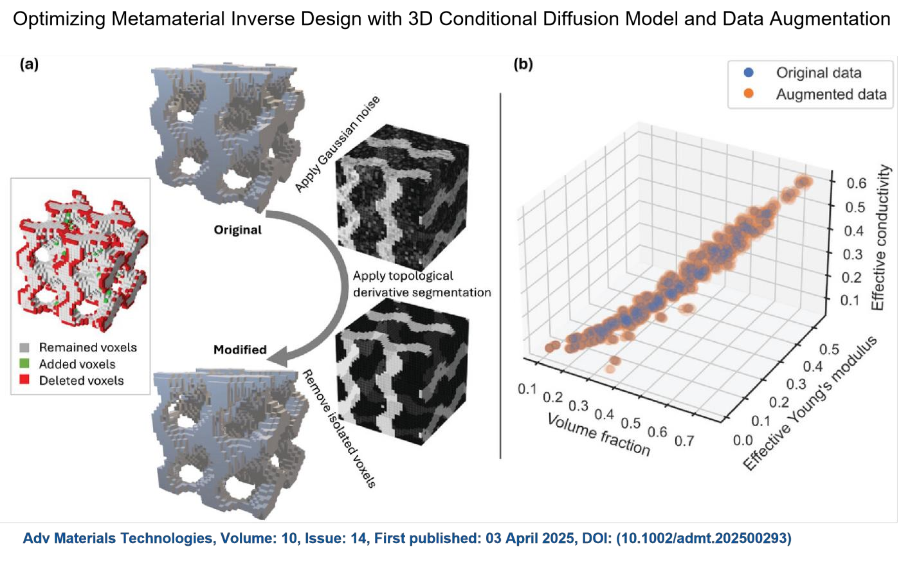

图17 超材料逆向设计：3D 条件扩散模型与数据增强。Figure 17 Metamaterial inverse design with a 3D conditional diffusion model and data augmentation.

 

<!-- summary -->

05<h2>总结：从对抗样本到生成式数据增强Summary: From Adversarial Examples to Generative Data Augmentation</h2>

两条路线共享同一套底层机制——学习数据空间中的有效扰动、利用高维空间的“线性敏感性”，最终都服务于模型的鲁棒性与泛化能力；差别在于扰动的目标与约束。

Both routes share the same underlying mechanisms — learning effective perturbations in data space and exploiting the linear sensitivity of high-dimensional space — and both ultimately serve robustness and generalization. They differ in the objective and constraints placed on the perturbation.

<table class="table">
<thead><tr><th>维度Dimension</th><th>对抗样本Adversarial examples</th><th>生成式数据增强Generative data augmentation</th></tr></thead>
<tbody>
<tr><td>扰动目标Perturbation goal</td><td>约束条件下的定向扰动生成，目标“破坏模型性能”Constrained, targeted perturbation aimed at breaking model performance</td><td>分布约束下的自然扰动生成，目标“保持语义、增加变化”Distribution-constrained, natural perturbation aimed at preserving semantics while adding variation</td></tr>
<tr><td>高维线性敏感性Linear sensitivity</td><td>定向累积扰动以实现错误分类Accumulating targeted perturbations to force misclassification</td><td>微小扰动不改变语义，仅增加多样性Small perturbations that leave semantics intact and add diversity</td></tr>
<tr><td>对模型的价值Value to the model</td><td>通过对抗训练暴露模型脆弱点，学会应对攻击（安全威胁）Adversarial training exposes vulnerabilities so the model learns to resist attacks (security threats)</td><td>通过补充训练数据覆盖更多场景，缓解数据稀缺与分布偏移Supplementary training data cover more scenarios, relieving data scarcity and distribution shift</td></tr>
</tbody>
</table>

核心判断：模型能力上限取决于数据质量、结构与组织方式。对抗样本揭示了数据空间中“危险的方向”，生成式数据增强则把这些方向转化为“有用的多样性”。Core claim: a model’s capability ceiling is set by data quality, structure and organization. Adversarial examples reveal the dangerous directions in data space; generative data augmentation turns those directions into useful diversity.

从对抗样本到生成式数据增强From adversarial examples to generative data augmentation

